# Kenya Water Points: Data Cleaning Project

A data cleaning project on real water point data for Kenya, built around a reusable 15-item cleaning checklist. The checklist was written from problems met on an earlier project, then run end to end on the Water Point Data Exchange (KEN) dataset (21,953 records, 54 columns). Every finding is logged, and every change is a fix, a flag, or a documented decision to leave the data alone.
## The problem
A repair budget built on water point data is only as good as the data. This file combines records from 15 organisations that recorded things in different ways. The project asks two things: how clean is the data, and once it is cleaned, what can it honestly say about which water points are failing?

## Dataset
- **Source:** Water Point Data Exchange (WPdx), shared on the Humanitarian Data Exchange: https://data.humdata.org/dataset/wpdx_ken
- **Files used:** wpdx_enhanced.csv (Kenya) for the cleaning; adm_analysis.csv (area summary) kept for reference
- **Size:** 21,953 records and 54 columns, plus a row of HXL tags that was removed from the working copy
- **Licence:** Creative Commons Attribution Share-Alike (CC BY-SA), as listed on the dataset page

## Data and licence
The data is the Water Point Data Exchange (KEN) dataset, published on the Humanitarian Data Exchange (https://data.humdata.org/dataset/wpdx_ken) under the Creative Commons Attribution Share-Alike (CC BY-SA) licence. Credit: Water Point Data Exchange (WPdx). The dataset page notes that it represents the best available information shared with the WPdx platform.

The original files in data/original are unchanged. The workbook in data/working is a modified version of that data. The changes are listed in its Findings Log and Run summary sheets: a row of tags removed, 22 spacing and 23 capitalisation fixes, 4 placeholder cells and 205 form-text cells relabelled, 13 empty columns deleted, and an install-year flag column added.In line with the share-alike term, that workbook, and the analysis workbook in the analysis folder (which contains a copy of the cleaned data), are also shared under CC BY-SA.The cleaning checklist and the write-up are my own work.

## The checklist
The checklist has 15 items in five groups: duplicates, blanks, consistency, data types and validation, plus process rules and a first look at the data. A running order sheet puts them in sequence: Prepare, Detect, Fix, Verify, Protect. It was improved five times while running it on this dataset, for example by adding wildcard searches for hidden placeholders, checks for numeric stand-ins like 0, and a check for capital-letter variants that filters cannot see.

## Tools Used
Microsoft Excel (COUNTBLANK, COUNTIF with wildcards, SUMPRODUCT, ISNUMBER, EXACT, TRIM, Find & Replace, Remove Duplicates, filters, PivotTables, charts)
, Git and GitHub.

## Process
1. **Prepare:** kept the original CSV untouched, worked on a copy, and took a first look at the size, columns and definitions.
2. **Detect:** found missing data and placeholder text across all 54 columns using one row of formulas, confirmed with a second method.
3. **Detect:** checked data types, spacing, capitalisation, and values against expected lists.
4. **Detect:** checked for duplicate IDs and duplicate rows, with a planted duplicate to prove each check works.
5. **Detect:** checked for impossible values, including comparisons between related columns.
6. **Fix:** corrected what was safe to correct, flagged what was uncertain, and left alone what could not be known.
7. **Verify:** re-ran the checks to confirm nothing broke and the counts still reconcile.
8. **Document:** logged every finding and decision, and summarised the run.
9. **Analyse:** built source, county, technology and install-year tables with COUNTIFS and PivotTables, tied each one to totals already checked, and compared every result by data source before trusting it.

## Data quality findings
- 13 of the 54 columns hold no data at all, and 4 more are 84% to 92% blank.
- 277 rows have "Unknown" in status_id, and 1,028 rows use 0 as an activity ID.
- 11,571 of the 13,578 Non-Functional points (about 85%) also report water available in status_id. The two columns measure different things, so this was flagged and not changed.
- 8 of Kenya's 47 counties have no records, so results describe 39 counties.
- 9 rows have install years that cannot be right (installed after the report date, 2028, or 1900).
- No duplicate IDs and no duplicate rows.

## What was fixed, flagged and left alone
- **Fixed:** 22 cells with doubled spaces, 23 cells with capitalisation variants, 4 "unknown 7" cells, 205 leftover form-text cells (relabelled "Other (not specified)"), and 13 empty columns removed.
- **Flagged:** 9 rows with suspicious install years, using a new install_year_flag column. The years were not changed.
- **Left unchanged, with reasons logged:** the mostly blank columns, the Unknown values in status_id, mixed-type IDs, and timestamps stored as text.
- **Open questions for the data owner:** whether "World Vision" and "World Vision International Kenya" are the same organisation, and why so many Non-Functional points report water available.

## Analysis: where is repair needed most?
**Question:** Which counties have the most non-functional water points, in number and as a share of the points recorded there? "Non-functional" means status_clean = "Non-Functional" (no longer working, whatever the season). Counties with fewer than 30 points are listed but not ranked by share.

**What I found first:** 12 of the 15 data sources mark every one of their points Non-Functional. Those 12 sources hold 12,179 points (55% of all rows) and about 90% of all non-functional points. The largest, Evidence Action, has 10,850 points, all marked Non-Functional, yet 10,502 of them record that water was available (status_id = Yes). That pattern looks more like a default value than a measurement, and it accounts for most of the 11,571 status disagreements found during cleaning. I could not prove the values wrong, so I raised it as a question for the data owner.

**What I did about it:** I reported each county's share twice: using all sources (61.85% overall) and using only the 3 sources whose statuses vary (14.3% overall). I ranked counties on the second.

**Result:** Only 14 of 39 counties have 30 or more points from the varied sources. Their shares run from 4.2% (Kajiado) to 20.5% (Makueni). The top five (Makueni, Siaya, Kisumu, Busia, Migori) sit between about 16% and 20%, close enough that their order is not firmly established. Baringo, Trans Nzoia, Homa Bay and Samburu look worst when all sources are used, but have only 0 to 3 points from the varied sources, so their condition is unknown, not proven bad.

**Limits:** The data is what contributors shared, not a census of water points. 8 of Kenya's 47 counties have no records, only 14 counties can be ranked, and the varied sources may survey different kinds of points from the others.

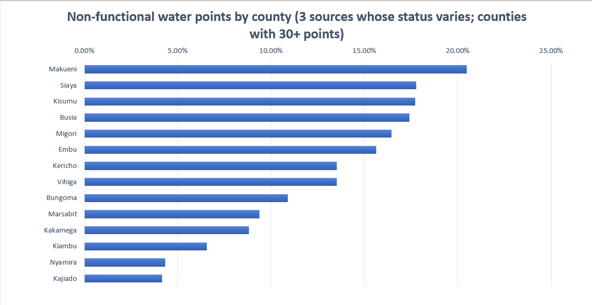
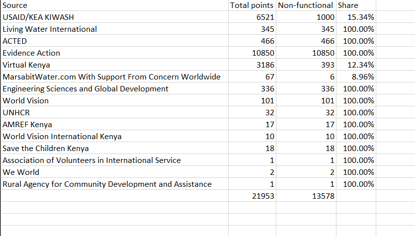

### Technology type
Motorized pumps have the lowest non-functional share (6.6%). The apparent gap between hand pumps and tapstands in the combined data comes mostly from which source supplied each technology.

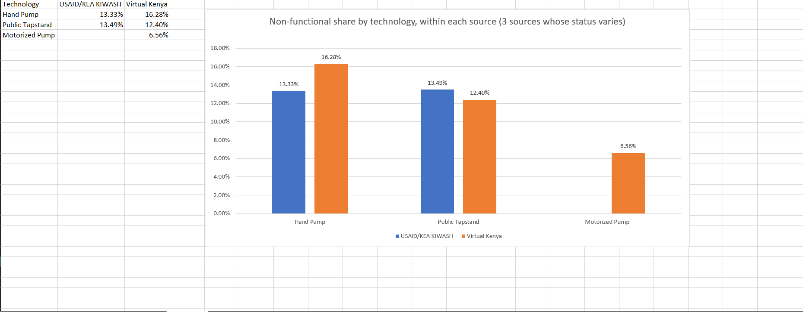

### Install year
Install year shows no consistent link with failure once the source is taken into account.

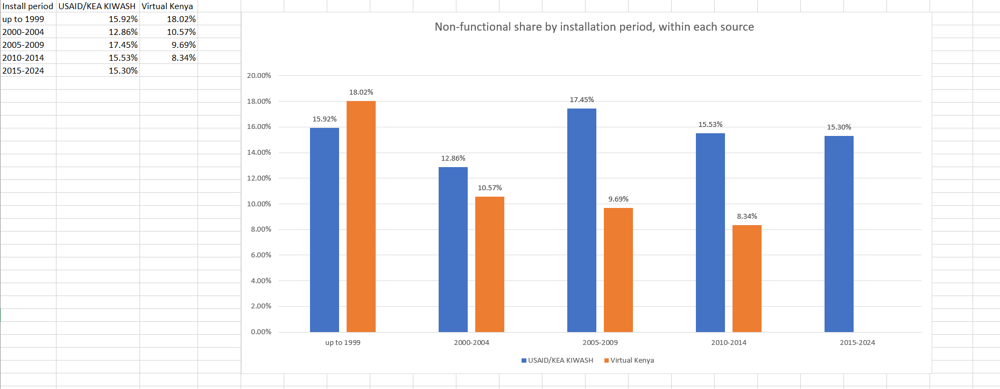

## Key Findings
1. 12 of the 15 data sources mark every one of their points Non-Functional (12,179 points, about 90% of all non-functional points). The overall 61.85% non-functional share mostly reflects who supplied the data, not the condition of the water points.
2. Using only the 3 sources whose statuses vary (9,774 points), 14.3% of points are non-functional. Among the 14 counties with 30 or more of those points, shares run from 4.2% (Kajiado) to 20.5% (Makueni). The top five (Makueni, Siaya, Kisumu, Busia, Migori) sit close together at about 16% to 20%, so their order is not firmly established.
3. Motorized pumps have the lowest non-functional share: 6.6% (259 points, all from Virtual Kenya), against 16.3% for hand pumps in the same source. Inside USAID/KEA KIWASH, hand pumps and tapstands fail equally often (13.3% against 13.5%), so the gap in the combined data (16.0% against 13.4%) largely comes from which source supplied each technology.
4. Install year shows no consistent link with failure. Older points fail about twice as often in Virtual Kenya (18.0% for points installed up to 1999, against 8.3% for 2010-2014), but there is no pattern in USAID/KEA KIWASH (12.9% to 17.4% across periods). The two sources also surveyed about nine years apart, so "older" does not mean the same thing in each.
5. Coverage is limited: 8 of Kenya's 47 counties have no records, only 14 counties have enough points to rank, and about 24% of the varied-source points have no water technology recorded.
## Screenshots

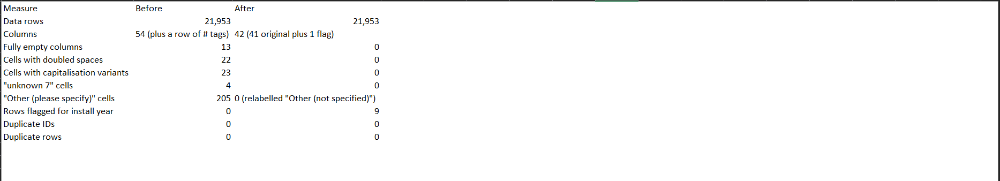
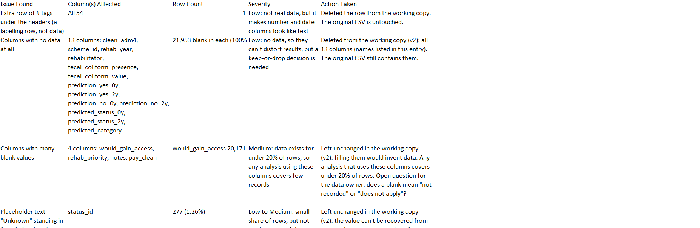
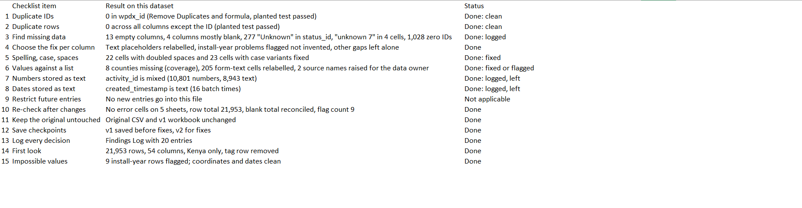
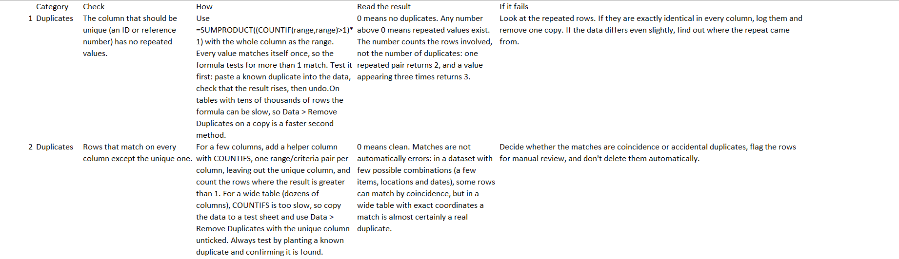
*The screenshot shows the first items. The full 16-item checklist is in the checklist folder.*

## Day 15: Asking the right questions

I wrote 10 questions the cleaned data could answer (sheet "Day 15 questions" in `analysis/wpdx-kenya-analysis.xlsx`). Eight are answered; two are still open (distance to a primary road, and how users pay). I answered my top 3 and wrote a one-page summary (sheet "Day 15 summary").

Same rules as the earlier analysis: only the 3 sources whose statuses vary are used (9,774 points, 1,399 non-functional = 14.3%), "Non-Functional" means status_clean = Non-Functional only, a share is reported only when a group has 30 or more points, and every result is checked within each source before it is trusted.

### Findings

- **Water source type (Q4):** Boreholes fail far more often than protected wells in USAID/KEA KIWASH (25.01% vs 4.29%), but the two are about the same in Virtual Kenya (12.27% vs 13.08%).
- **People assigned to non-functional points (Q6):** Makueni, Kisumu and Busia have the most people assigned to non-functional points (52.40% of the 701,622 people in total, a modelled estimate), but 85.2% of the top 5 counties' people come from one source, USAID/KEA KIWASH, so this ranking should not be read as the counties with the greatest need.
- **Management type (Q7):** In USAID/KEA KIWASH, Community Management points fail more often than Private Operator/Delegated Manager points (16.69% vs 9.11%), but in Virtual Kenya the two are almost the same (8.73% vs 9.40%).

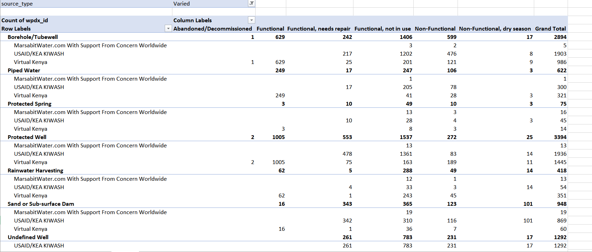

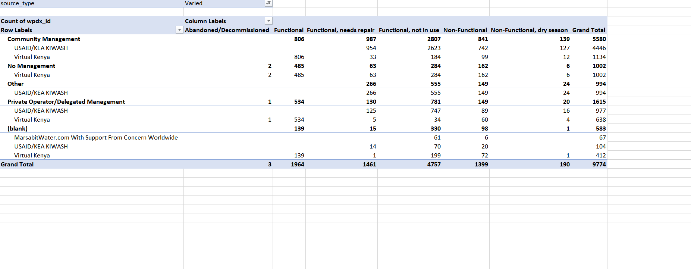

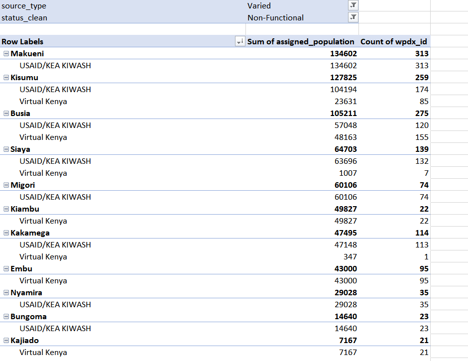

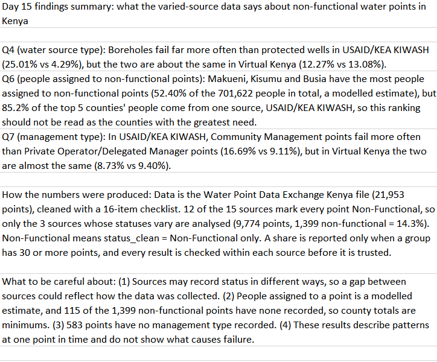

### What to be careful about

- Sources may record status in different ways, so a gap between sources could reflect how the data was collected.
- People assigned to a point is a modelled estimate, and 115 of the 1,399 non-functional points have none recorded, so county totals are minimums.
- 583 points have no management type recorded.
- These results describe patterns at one point in time and do not show what causes failure.

## Files
- **checklist:** the reusable cleaning checklist (data-cleaning-checklist.xlsx)
- **data/original:** the downloaded CSV files, unchanged
- **data/working:** the cleaned workbook with the findings log, run summary and checklist run (wpdx-kenya-cleaned.xlsx)
- **analysis:** the analysis workbook (wpdx-kenya-analysis.xlsx) with the source and county tables, the ranking, the chart and the analysis log
- **images:** screenshots used in this README

## Author
Reagan, Civil Engineering student at JKUAT, building a data analytics portfolio